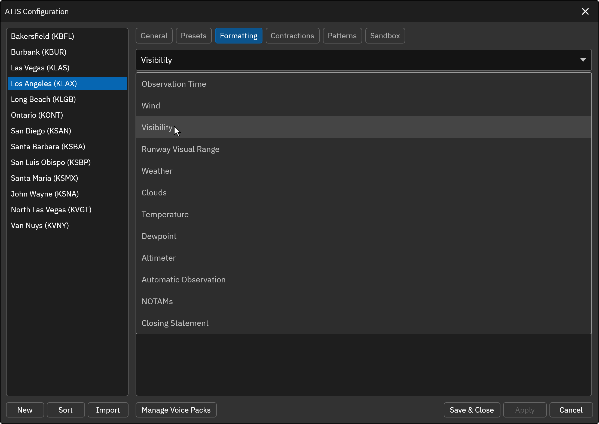

# Formatting

The Formatting tab allows you to customize specific components of the ATIS. To customize a component, select it from the dropdown at the top of the tab. Components with more than one page, such as Wind, Visibility and Weather, show a tab for each page above the settings. Wind Shear, Runway Condition, Remark Wind, Trend Forecast and Transition Level are listed only for non-FAA stations.

