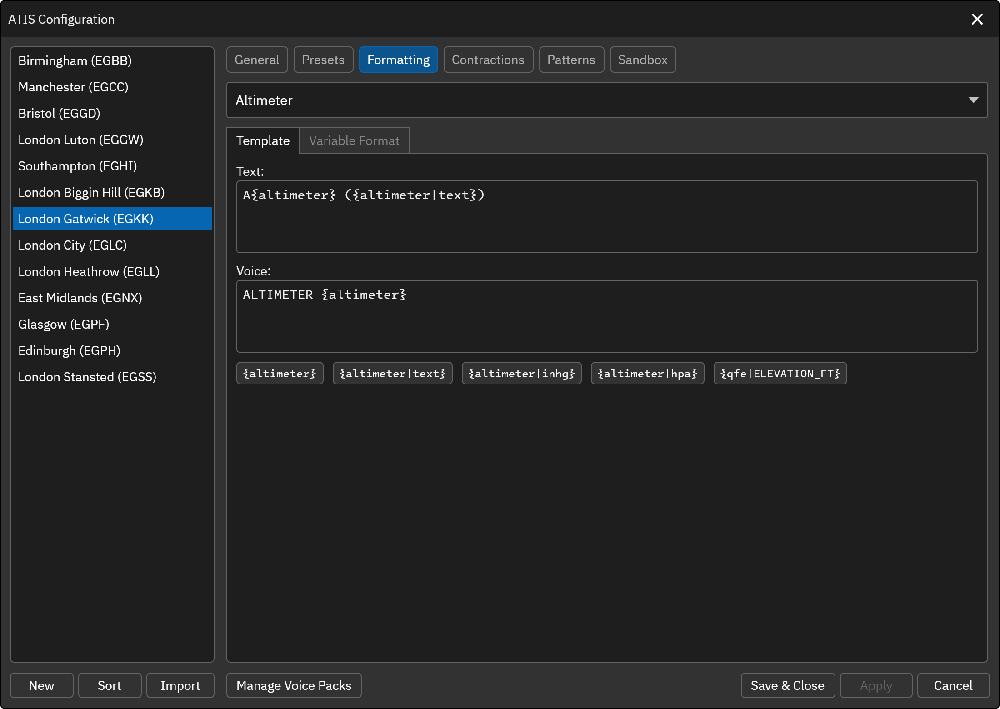
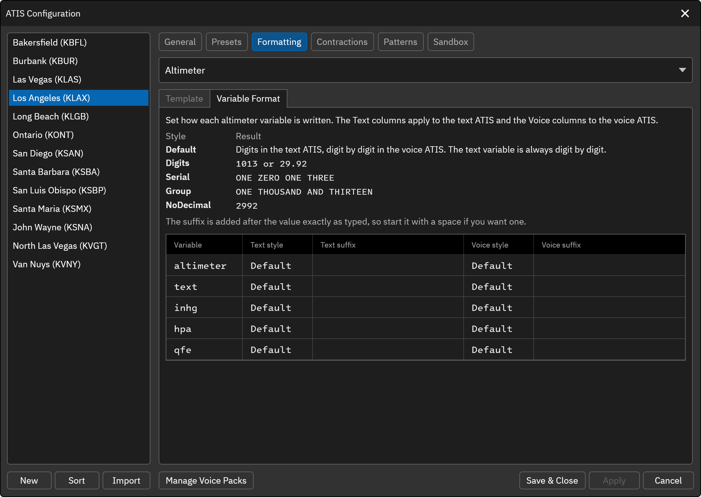

# Altimeter

The altimeter element from the METAR.

* `{altimeter}` ... The numeric altimeter value (e.g. 2998 or 1013)
* `{altimeter|inhg}` ... The numeric altimeter value converted to inches of mercury (inHg)
* `{altimeter|hpa}` ... The numeric altimeter value converted to hectopascals (hPa)
* `{altimeter|text}` ... The altimeter value translated to words (e.g. TWO NINER NINER TWO)
* `{altimeter|ICAO}` ... The altimeter value from the METAR of another airport, where `ICAO` is its four letter code (e.g. `{altimeter|EGKK}`). The value is shown as that METAR reports it. If the METAR cannot be found, the variable is left as typed.
* `{qfe|ELEVATION_FT}` ... Aerodrome atmospheric pressure. Replace `ELEVATION_FT` with the field elevation in feet (e.g. `{qfe|328}`). Clicking the variable button asks for the elevation and inserts it for you. The button is only shown for non-FAA stations, but the variable can be typed into the template of any station.

## Variable Format

The Variable Format tab controls how each numeric variable is written, separately for the text ATIS and the voice ATIS. Rows are available for `{altimeter}`, `{altimeter|text}`, `{altimeter|inhg}`, `{altimeter|hpa}` and `{qfe}`. Every row is one variable and has a **Text** and a **Voice** column group, each with a **Style** and a **Suffix**.

**Style** 
* **Default** ... Digits in the text ATIS and digit by digit in the voice ATIS. `{altimeter|text}` is always digit by digit.
* **Digits** ... Plain digits (e.g. 1013 or 29.92).
* **Serial** ... Each digit read on its own (e.g. ONE ZERO ONE THREE).
* **Group** ... A whole number read in words (e.g. ONE THOUSAND AND THIRTEEN). A decimal value such as inHg falls back to digit by digit.
* **NoDecimal** ... Drops the decimal point from inHg values, mainly for `{altimeter|inhg}`: `2992` in the text ATIS and TWO NINER NINER TWO in the voice ATIS.

**Suffix** 
Text appended to the value exactly as typed, so include a leading space if you need one (for example, a space followed by `hPa`).

Every setting defaults to the previous behavior, so existing profiles are unchanged.

`{altimeter|text}` can now be used in the voice ATIS template as well as the text ATIS template.
