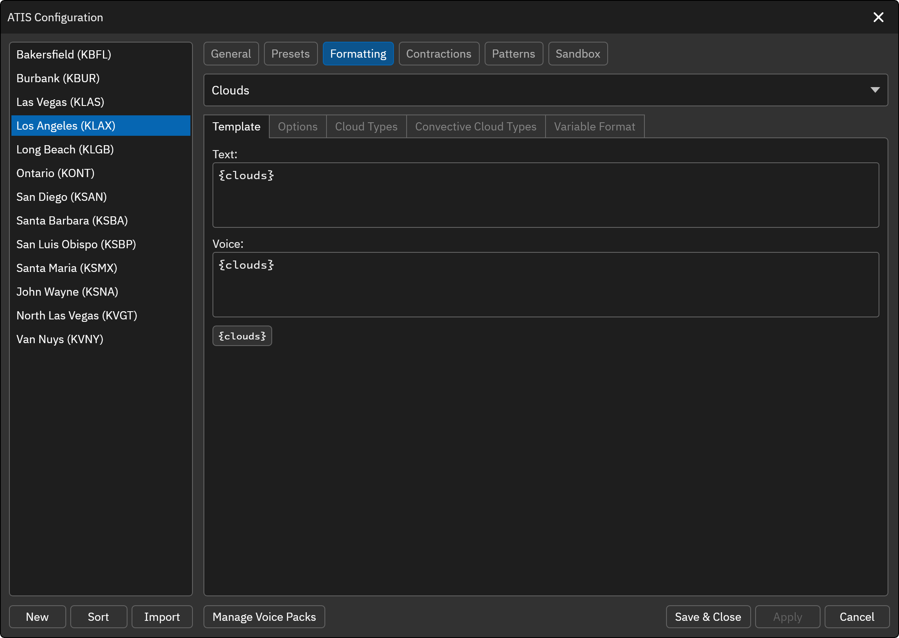
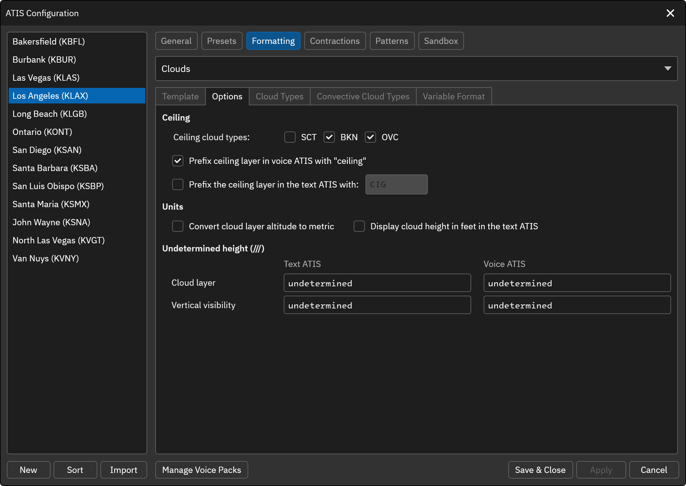
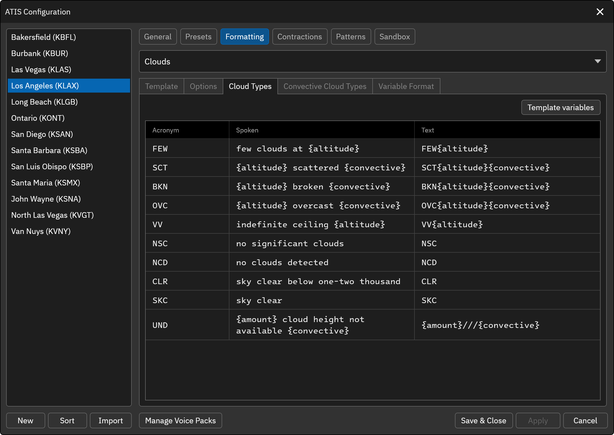
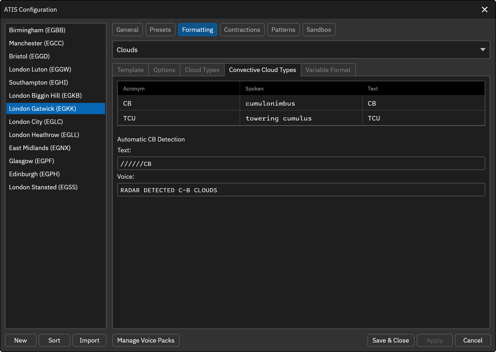
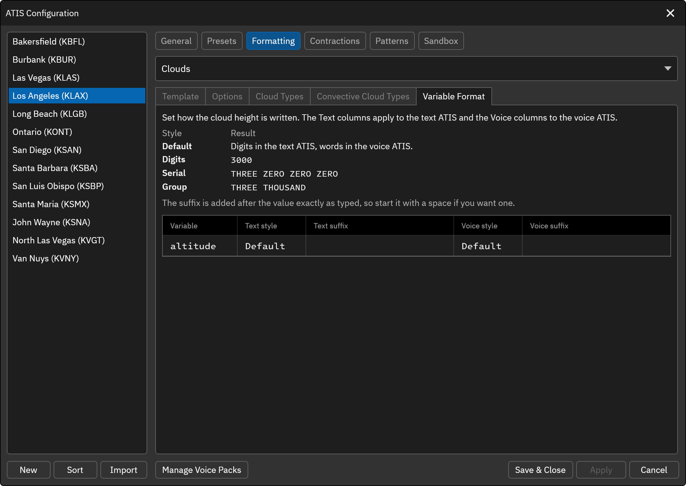

# Clouds

This element represents the cloud layers information obtained from the METAR reports.

* `{clouds}` ... The cloud layers (e.g. FEW050 SCT100)

## Options
The Options tab sets how the ceiling is identified, the units used for cloud heights and the text used when a height is not reported.

### Ceiling
The ceiling is the lowest cloud layer of the selected types that has a reported height.

* **Ceiling cloud types**: The cloud types that count as a ceiling: SCT, BKN and OVC. The default is BKN and OVC.
* **Prefix ceiling layer in voice ATIS with "ceiling"**: When enabled (the default), the ceiling layer is spoken with the word "ceiling" in front of it. For example, it will be spoken as "CEILING ONE THOUSAND FOUR HUNDRED OVERCAST, TWO THOUSAND BROKEN."
* **Prefix the ceiling layer in the text ATIS with**: When enabled (off by default), the ceiling layer is shown with this prefix in the text ATIS. The default prefix is `CIG`, so the layer reads, for example, `CIG BKN014`.

### Convert cloud layer altitude to metric
If this option is selected, the altitude (height) of the cloud layer will be converted to the metric unit in both the voice and text ATIS.

### Display cloud height in feet
METAR cloud heights are in hundreds of feet, so `FEW010` is 1000 feet. If this option is enabled, the text ATIS shows the height in feet instead. For example, FEW010 will be displayed as FEW1000. This option has no effect when the altitude is converted to metric.

### Undetermined height (///)
The text used when the height of a cloud layer or the vertical visibility is not reported (`///`). Set the voice and text values separately for a **cloud layer** and for **vertical visibility**. The text replaces `{altitude}` in the Cloud Types.

### Undetermined cloud type
A layer whose height is not reported (for example `FEW///` or `BKN///CB`) uses the **UND** row in Cloud Types. In that row, `{amount}` is replaced with the layer amount (e.g. FEW or BKN), so you can word these layers differently from layers with a known height.

## Cloud Types
Specify how the cloud types should be articulated in the voice ATIS.

* `{altitude}`: Represents the altitude or height of the cloud layer. This variable can be used to insert the specific altitude of the cloud layer in the voice or text ATIS, ensuring accurate reporting of cloud heights. You can optionally include a format parameter to specify the number of digits to display in the text ATIS. For example, to display the altitude with five digits, use the variable `{altitude:5}`.
* `{convective}`: If the cloud layer is identified as a convective layer (e.g., cumulonimbus clouds), this variable will include the spoken text for the convective layer. For example, if the layer is scattered cumulonimbus clouds at 25,000 feet, the spoken ATIS would say "TWO FIVE THOUSAND SCATTERED CUMULONIMBUS".

The following variables are also available in the Cloud Types:

* `{altitude:N}` ... Text ATIS only. The height zero-padded to *N* digits, for example `{altitude:2}` gives 03 for 300 feet. Without *N*, the height is padded to 3 digits.
* `{amount}` ... The **UND** row only. The layer amount, such as FEW or BKN.
* `{feet}` ... The word "feet" when the height is known, and empty when the height is `///` or when cloud heights are converted to metric, so the unit is dropped together with the height.

## Convective Cloud Types
Specify how the convective cloud types should be articulated in the voice ATIS.

## Automatic CB Detection
Available for non-FAA stations. When the METAR reports `//////CB`, a cumulonimbus cloud detected by weather radar with no reported amount or height, the ATIS uses the values set under **Automatic CB Detection** on the Convective Cloud Types tab. The default text is `//////CB` and the default voice is `RADAR DETECTED C-B CLOUDS`.

## Convective Cloud Types (Text)
The Convective Cloud Types table also has a **Text** column. It sets how each convective type (CB, TCU) is shown in the text ATIS, independent of the spoken text. By default the text ATIS shows the METAR acronym.

## Variable Format

The Variable Format tab sets the number style and suffix for the `{altitude}` variable, independently for the text and voice ATIS. For example, the text ATIS can append `FT` while the voice ATIS speaks digit-by-digit words. When cloud heights are converted to metric, the spoken "meters" word is still added after the formatted number.

**Style** 
* **Default** ... Digits in the text ATIS and words in the voice ATIS.
* **Digits** ... Plain digits (e.g. 3000).
* **Serial** ... Each digit read on its own (e.g. THREE ZERO ZERO ZERO).
* **Group** ... A whole number read in words (e.g. THREE THOUSAND).

**Suffix** 
Text appended to the value exactly as typed.
