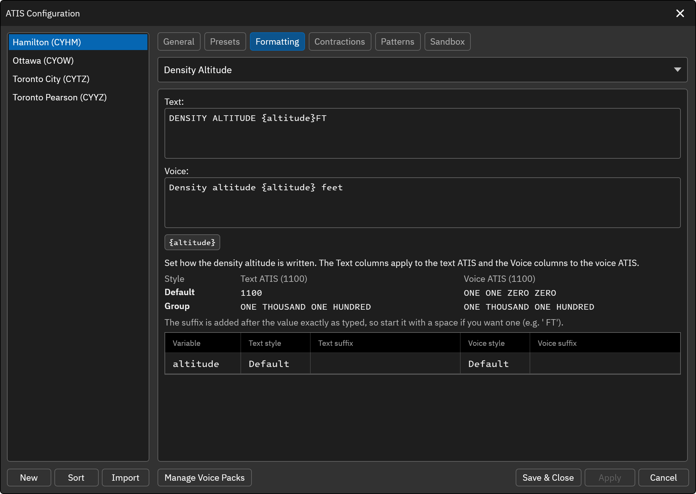

# Density Altitude

The Density Altitude element represents the density altitude reported in the remarks section of the METAR (e.g. `RMK ... DENSITY ALT 1100FT`). To include this element in the Preset ATIS template, use the `[DENSITY_ALT]` variable. This component is only available for non-FAA ATIS stations, and nothing is output when the METAR has no density altitude.

Set the text and voice templates for the density altitude. The defaults are:

* **Text**: `DENSITY ALTITUDE {altitude}FT`
* **Voice**: `Density altitude {altitude} feet`

The following variables are available:

* `{altitude}` ... The density altitude in feet. A negative value is prefixed with a minus.

Below the templates, set how `{altitude}` is written, separately for the text ATIS and the voice ATIS. Each has a **Style** and a **Suffix**.

**Style**<br/>
* **Default** ... Digits in the text ATIS (e.g. 1100) and digit by digit in the voice ATIS (e.g. ONE ONE ZERO ZERO).
* **Group** ... The whole number read in words (e.g. ONE THOUSAND ONE HUNDRED).

**Suffix**<br/>
Text appended to the value exactly as typed, so include a leading space if you need one.

For example, with this METAR:

```
CYHM 052100Z 24010G16KT 15SM FEW030 BKN038 BKN045 14/08 A2975 RMK CF1SC6SC1 CF TR SLP078 DENSITY ALT 1100FT
```

the default templates produce `DENSITY ALTITUDE 1100FT` in the text ATIS and "Density altitude one one zero zero feet" in the voice ATIS.


