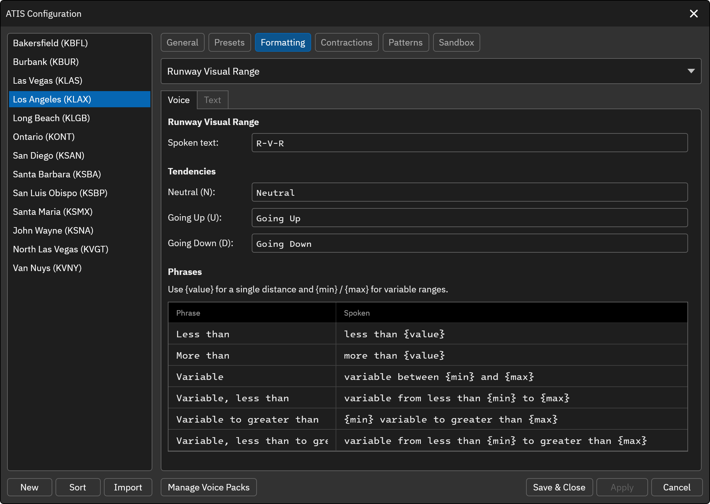

# Runway Visual Range

The Runway Visual Range (RVR) element represents the RVR groups from the METAR report. To include this element in the Preset ATIS template, use the `[RVR]` variable.

## Voice
The Voice tab sets how runway visual range is spoken in the voice ATIS.

**Runway Visual Range** 
The text spoken to announce runway visual range (default "R-V-R"). Leave blank to omit the label.

**Tendencies** 
The text spoken for the neutral (N), going up (U) and going down (D) tendencies.

**Phrases** 
Edit the phrases used to read RVR values. Use `{value}` for a single distance and `{min}` and `{max}` for variable ranges. The defaults match the previous wording.

|Phrase|Default|
|---|---|
|Less than|`less than {value}`|
|More than|`more than {value}`|
|Variable|`variable between {min} and {max}`|
|Variable, less than|`variable from less than {min} to {max}`|
|Variable to greater than|`{min} variable to greater than {max}`|
|Variable, less than to greater than|`variable from less than {min} to greater than {max}`|

## Text
The Text tab sets what is shown in the text ATIS.

**Tendencies** 
The text shown for each tendency code (N, U, D), independent of the spoken text on the Voice tab. By default the METAR code is shown.
