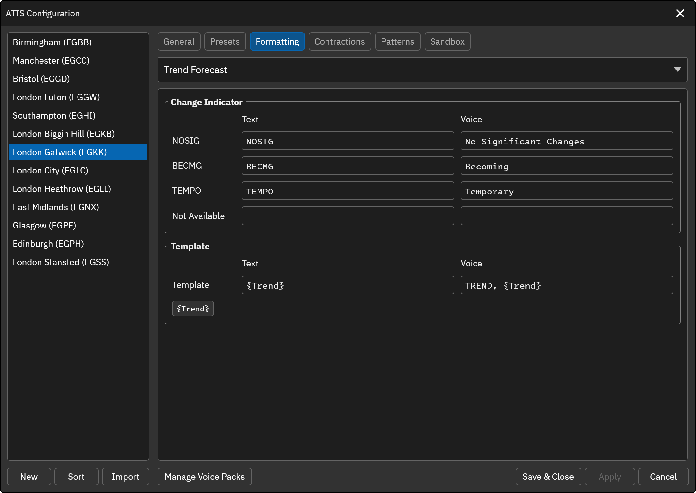

# Trend Forecast

The Trend Forecast element represents the TREND forecast at the end of the METAR. To include this element in the Preset ATIS template, use the `[TREND]` variable. This component is only available for non-FAA ATIS stations.

Under **Change Indicator**, set the text and voice values used for each trend change indicator:

| Indicator | Default text | Default voice |
|-|-|-|
| **NOSIG** | `NOSIG` | No Significant Changes |
| **BECMG** | `BECMG` | Becoming |
| **TEMPO** | `TEMPO` | Temporary |

**Not Available** is the text to print and/or say when the TREND is not available in the METAR. It is empty by default.

Under **Template**, set the text and voice templates that wrap the trend forecast. The defaults are:

* **Text**: `{Trend}`
* **Voice**: `TREND, {Trend}`

`{Trend}` is replaced by the trend forecast (e.g. NOSIG). The template is only applied when the METAR has a trend forecast, so it does not wrap the **Not Available** text.

