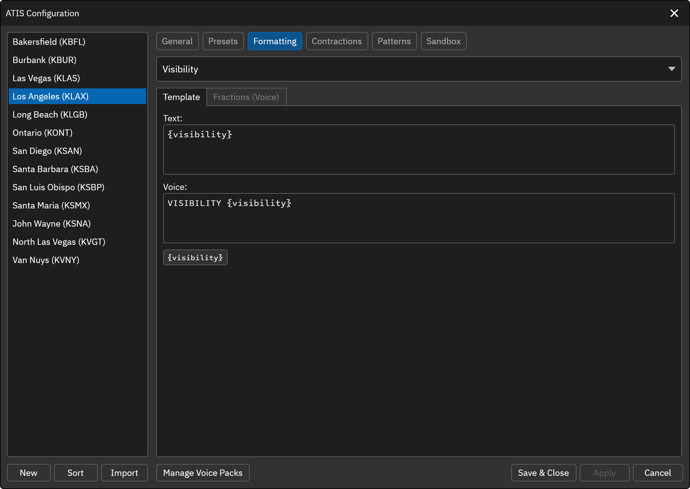
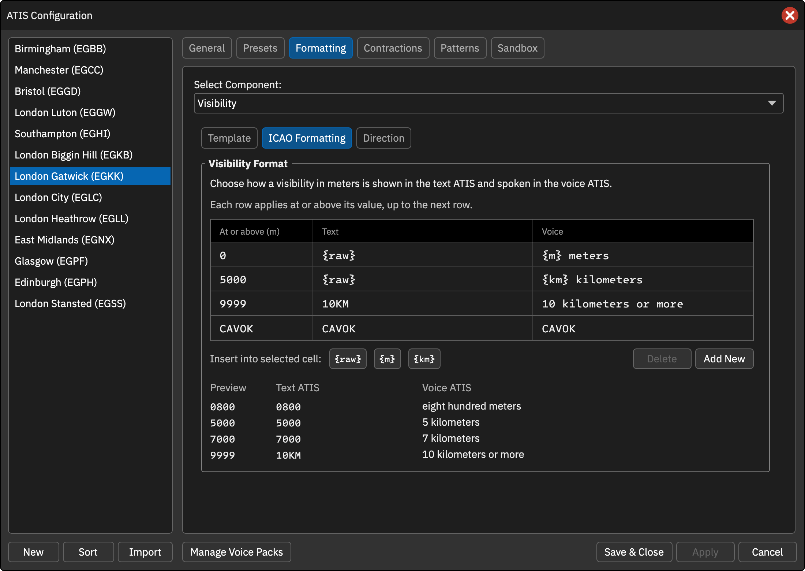
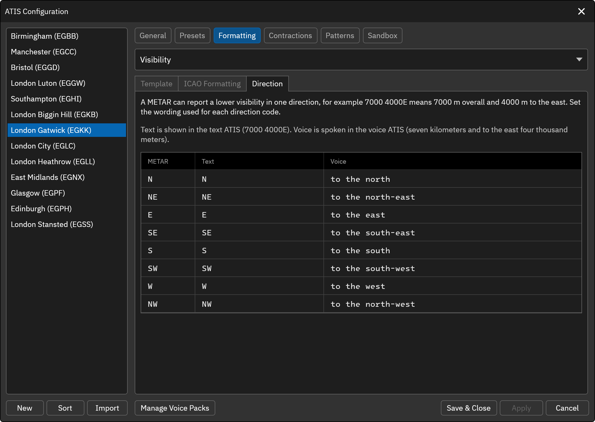
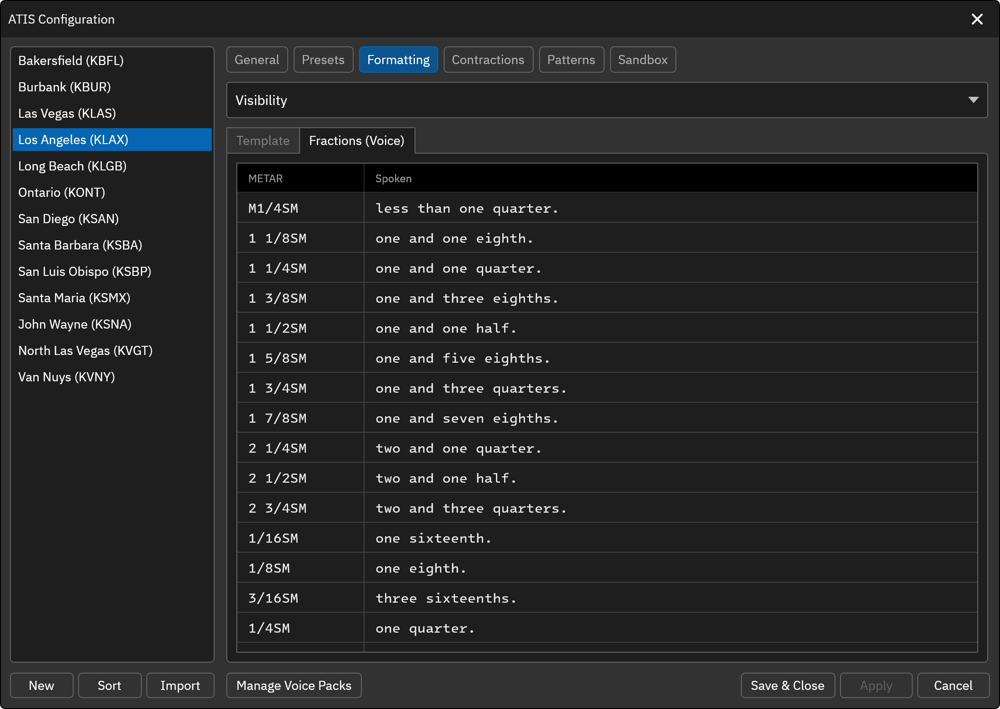

# Visibility

The Visibility element represents the visibility value obtained from the METAR report. To include this element in the Preset ATIS template, use the `[VIS]` variable.

* `{visibility}` ... The visibility value (e.g. 10SM)

## ICAO Formatting
The ICAO Formatting tab sets how a visibility in meters is written in the text ATIS and spoken in the voice ATIS. This tab is only visible for non-FAA ATIS stations.

Each row of the table starts at the value in **At or above (m)** and applies to every visibility up to the value of the next row. The **Text** column is what the text ATIS shows and the **Voice** column is what the voice ATIS speaks. These variables are available:

* `{raw}` ... The visibility as reported in the METAR (e.g. 0800). Text column only.
* `{m}` ... The visibility in meters. Shown as digits in the text ATIS (e.g. 800) and spoken in words in the voice ATIS (e.g. eight hundred).
* `{km}` ... The visibility in kilometers (e.g. 7 or 6.5). In the voice ATIS each digit is read on its own and a decimal is spoken as "point", so 7.5 is "seven point five" and 10 is "one zero". If **Use "decimal" terminology in spoken text** is enabled in the [General Configuration](/docs/client/atis-configuration/general), it is spoken as "decimal" instead.

Select a cell and click a variable button to insert it there. Use **Add New** to add a row and **Delete** to remove the selected row. If no row matches a visibility, the text ATIS shows the METAR value and the voice ATIS speaks the visibility in meters.

The default rows write visibilities below 5000 meters in meters, 5000 and above in kilometers, and report 9999 as 10 kilometers or more:

|At or above (m)|Text|Voice|
|---|---|---|
|0|`{raw}`|`{m} meters`|
|5000|`{raw}`|`{km} kilometers`|
|9999|`10KM`|`10 kilometers or more`|

The preview below the table shows how a few sample visibilities and CAVOK come out in the text and voice ATIS, so you can check your rows as you edit them. Profiles from earlier versions are migrated to these rows automatically and sound the same.

**CAVOK (Text ATIS)** 
The text displayed in the text ATIS when the METAR reports CAVOK. The default is "CAVOK".

**CAVOK (Voice ATIS)** 
The text spoken in the voice ATIS when the METAR reports CAVOK. The default is "CAVOK".

When the METAR reports CAVOK, the visibility template is not used. The CAVOK text and voice above are used instead.

## Direction
A METAR can report a lower visibility in one direction, for example `7000 4000E` means 7000 meters overall and 4000 meters to the east. The Direction tab (non-FAA stations) sets the wording used for each direction code (N, NE, E, SE, S, SW, W and NW).

**Text** 
How the direction is shown in the text ATIS. By default the METAR direction abbreviation is shown (e.g. `7000 4000E`).

**Voice** 
How the direction is spoken in the voice ATIS. The defaults are "to the north", "to the north-east" and so on, so the example above is spoken as "seven kilometers and to the east four thousand meters".

## Fractions (Voice)

This tab (FAA stations) sets the spoken text for fractional visibility values such as `1/2SM` or `1 1/2SM`. Each row is the METAR value and the text spoken in the voice ATIS. The defaults match the previous wording.

The text ATIS continues to show the METAR value as received.
